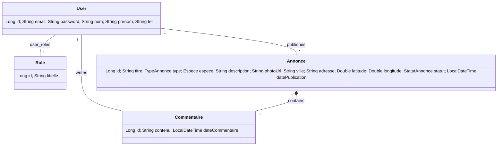

# Architecture and requirement notes

## Purpose
AdoptiPattes connects people who want to adopt an animal, report a stray, or ask the community for advice. Visitors can read all posts; members publish and comment; administrators moderate content and see the user directory.

## Class diagram

## Request flow
Angular component → dedicated HttpClient service → JWT interceptor → Spring Security → REST controller → transactional service → JPA repository → MySQL. DTO mapping occurs within the transaction, so lazy relationships never leak outside the service. Entities are never serialized directly. Passwords use BCrypt and are omitted from every response.

## Validation and authorization
Annonce type: ADOPTION, ANIMAL_ERRANT, DEMANDE_CONSEIL. Species: CHAT, CHIEN, AUTRE. Status: OUVERTE, EN_COURS, RESOLUE. Strays require valid latitude and longitude. Photos accept HTTP(S) URLs only. Creation time and authorship are server-owned. Registration ignores client-supplied privileges. All edits and deletions require ADMIN, including edits to a member's own post.

## Frontend
Standalone Angular components use Material forms, selects, buttons, dialogs, spinner and table. Signals hold async state. Category and city searches reach the server and cancel obsolete requests. The app offers public routes, authenticated publication, admin moderation and member listing. Original lavender cat artwork keeps a consistent visual style; decorative cats are keyboard-accessible buttons, can be paused/hidden, and respect reduced-motion preferences.

## Persistence and notifications
MySQL is the default. The local demo uses persistent H2. An announcement owns its comments, which are cascade-deleted. Registration publishes an event after the transaction commits; JavaMailSender delivers the administrator notification. Failed mail delivery is logged without misreporting a saved account as unsuccessful. A production mail queue/retry policy could be added later.

## Verification and limits
Automated tests cover authorization, client author/role tampering, CRUD, cascade deletion, missing IDs, URL/GPS validation, safe DTOs, CORS and registration notification composition. The delivery includes the test results in VERIFICATION.md. A deployed VPS, instructor approval of the alternate template, and external SMTP credentials remain environment-specific steps. Photo uploads, private messages and real-time notifications are outside the assignment scope.
